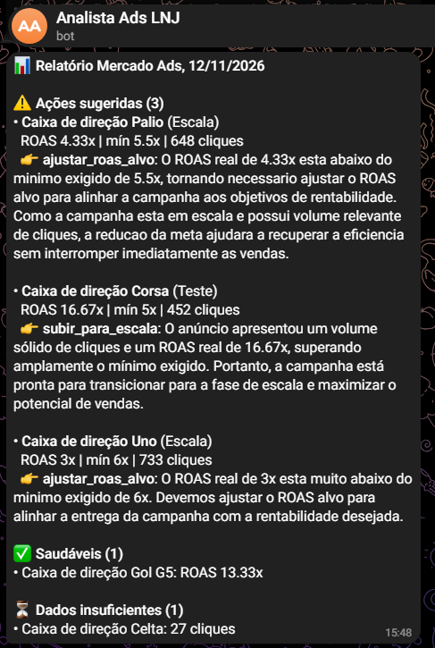
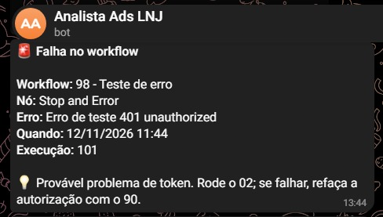
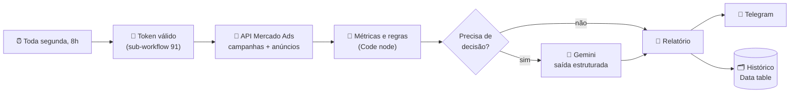
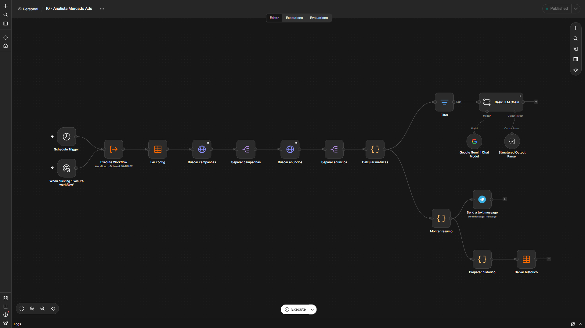

# 📊 Analista Semanal de Mercado Ads (n8n + IA)

Automação que analisa toda semana as campanhas de **Mercado Ads** de uma loja real de autopeças no Mercado Livre, aplica regras de negócio a cada anúncio e usa **IA apenas nos casos que precisam de decisão**, entregando um relatório no **Telegram**.


<table>
  <tr>
    <td align="center" valign="top" width="50%">
      
      <br>
      <sub>Relatório semanal (dados de demonstração)</sub>
    </td>
    <td align="center" valign="top" width="50%">
      
      <br>
      <sub>Alerta automático de falha, com dica de diagnóstico</sub>
    </td>
  </tr>
</table>

---

## 🎯 O problema

Eu gerencio duas campanhas de Mercado Ads (**Escala**, com os anúncios campeões, e **Teste**, com os candidatos). Toda semana eu precisava abrir o painel, olhar anúncio por anúncio e decidir quem sobe, quem desce e se o ROAS alvo precisa de ajuste. Este projeto faz essa triagem sozinho e me entrega só o que exige atenção.

## ⚙️ Como funciona





Cada anúncio recebe um status calculado **por código, não por IA**:

| Status | Regra |
|---|---|
| `sem_entrega` | 0 impressões no período |
| `dados_insuficientes` | menos de 130 cliques **e** menos de R$ 50 gastos |
| `abaixo_do_minimo` | ROAS real abaixo do ROAS alvo da campanha → **vai para a IA** |
| `candidato_escala` | na Teste, com ROAS ≥ 1,5× o alvo → **vai para a IA** |
| `saudavel` | dentro do esperado |

## 🧠 Decisões de projeto

- **Regras no código, IA na interpretação.** Cálculos e classificação são determinísticos. O LLM só recebe os casos já filtrados e sugere uma ação com justificativa.
- **Workflow, não agente, no fluxo principal.** O processo é fixo e previsível, então um agente só traria custo e imprevisibilidade. (Um agente investigador está nos próximos passos, para os casos em que o *porquê* varia.)
- **Ações restritas às alavancas reais.** A saída da IA usa um `enum` (`manter`, `subir_para_escala`, `descer_para_teste`, `pausar_anuncio`, `ajustar_roas_alvo`, `revisar_preco`). Sem isso, o modelo sugeria "negativar palavras-chave", algo que não existe no Mercado Ads.
- **Janela que respeita a atribuição.** A análise usa 14 dias terminando 3 dias atrás, porque vendas atribuídas a anúncios demoram a aparecer.
- **Humano no controle.** O sistema sugere; quem decide sou eu. A decisão é registrada no histórico para medir, depois, se as sugestões funcionaram.
- **Tolerância a falhas.** Retry nas chamadas de API, alerta de erro com dica de diagnóstico no Telegram e, se a IA falhar, o relatório sai mesmo assim (sem a análise).
- **Segredos fora dos workflows.** Tokens, IDs e configurações ficam em Data tables do n8n. Os JSONs versionados não contêm dados sensíveis, e um *pre-commit hook* bloqueia commits com tokens.

## 🗂️ Workflows

| Workflow | Função |
|---|---|
| `10 - Analista Mercado Ads` | **Fluxo principal**: coleta, regras, IA, relatório e histórico |
| `91 - Obter token ML` | Sub-workflow que devolve um `access_token` válido, renovando quando necessário |
| `90 - Setup tokens ML` | Autorização inicial OAuth (roda uma única vez) |
| `99 - Alerta de erros` | Error Workflow: avisa no Telegram qual nó falhou e sugere a causa |
| `02 - Teste API ML` | Teste rápido de conexão com a API |
| `98 - Teste de erro` | Dispara um erro proposital para testar o alerta |
| `01 - Teste IA` | Protótipo com dados fictícios (planilha demo) |

## 🚀 Como rodar

**Pré-requisitos:** Docker, um app no [Mercado Livre Developers](https://developers.mercadolivre.com.br/) com permissão de Publicidade, uma chave da API do Gemini e um bot do Telegram.

1. **Suba o n8n**
   ```bash
   docker volume create n8n_data
   docker run -d --name n8n --restart unless-stopped -p 5678:5678 -v n8n_data:/home/node/.n8n docker.n8n.io/n8nio/n8n
   ```
2. **Crie as Data tables** no n8n:
   - `ml_auth`: `client_id`, `client_secret`, `access_token`, `refresh_token`, `expires_at` (preencha só as duas primeiras)
   - `config`: `advertiser_id`, `chat_id`
   - `historico`: colunas listadas no nó *Preparar histórico* do workflow 10
3. **Importe os workflows** da pasta [`workflows/`](workflows/) e crie as credenciais do **Gemini** e do **Telegram**.
4. **Autorize o Mercado Livre:** gere o código em `https://auth.mercadolivre.com.br/authorization?response_type=code&client_id=SEU_APP_ID&redirect_uri=SUA_REDIRECT_URI`, cole no workflow `90` e execute.
5. **Teste** com o `02` e depois execute o `10` manualmente.
6. **Publique** o `10` e defina o `99` como Error Workflow do `10` e do `91`.

### Exportar os workflows

```powershell
pwsh -ExecutionPolicy Bypass -File .\exportar.ps1
```
Exporta todos os workflows via CLI do n8n, ignora os arquivados e remove metadados pessoais antes de salvar em `workflows/`.

## 📈 Resultados

> 🔄 **Em coleta.** O primeiro relatório real roda em 16/11/2026. Esta seção será atualizada com a evolução do ROAS e a taxa de acerto das sugestões da IA.

Primeiros achados, já no dia da implantação:
- a campanha Escala estava usando **cerca de 20% do orçamento diário**, sinal de ROAS alvo alto demais;
- **3 anúncios sem nenhuma impressão**, todos de peças recondicionadas, o que indica uma possível restrição de entrega a investigar.

## 🛣️ Próximos passos

- [ ] Regra de nível de campanha (uso do orçamento → sugerir ajuste do ROAS alvo)
- [ ] Aprovação das sugestões por botões no Telegram, aplicando a mudança via API
- [ ] Agente investigador com ferramentas só de leitura, para explicar quedas de desempenho
- [ ] Modo demo no workflow principal, para rodar sem conta no Mercado Livre

---

Feito por **João Gabriel**: [GitHub](https://github.com/joaogabriel-11) · [LinkedIn](https://www.linkedin.com/in/joaogabriel11)
